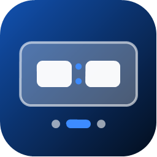
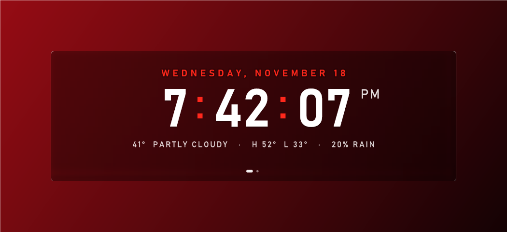
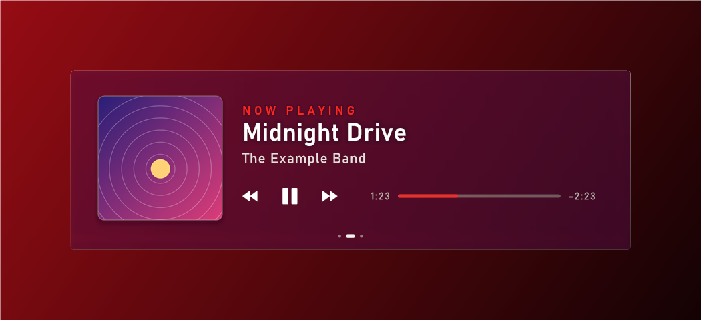
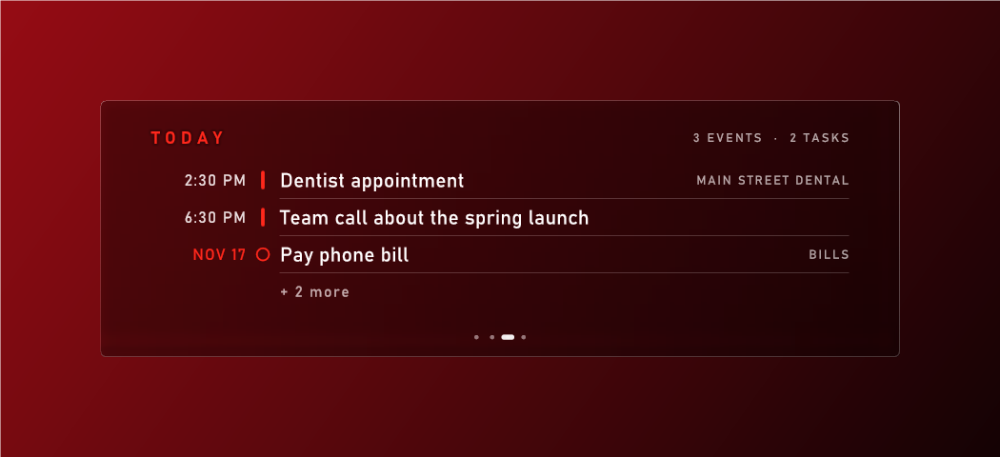
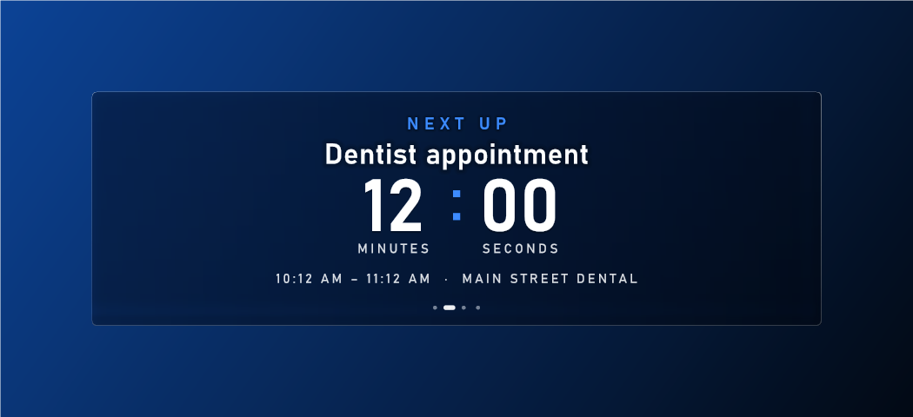
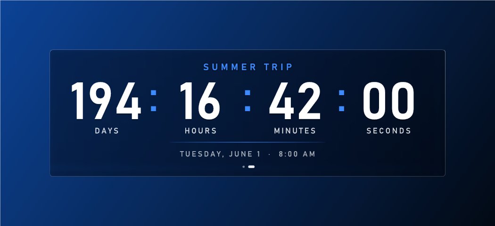

<h1 align="center">C.A.R.S. Glance</h1>

<b>Your day at a glance, right on the desktop.</b> 
A frosted-glass panel in the middle of every display: the time and weather, what's playing, your calendar and tasks, and the countdowns you care about.

<a href="https://github.com/CarCar08/cars-glance/releases/latest"><b>Download for Windows</b></a> · <a href="docs/install.md">Install guide</a> · <a href="CHANGELOG.md">What's new</a> · <a href="docs/privacy.md">Privacy</a>

## What it does

Glance lives **on the desktop layer**: above your wallpaper, under every window, and it never takes focus. Windows blurs your live wallpaper behind the glass. Show the desktop (<kbd>Win</kbd>+<kbd>D</kbd>) and it's there.

| | |
|---|---|
|  | **Now Playing.** Cover, title, artist and progress for any player that reports to Windows (Spotify, Apple Music, Cider, your browser…), with previous / play-pause / next. It takes the screen while music plays. |
|  | **Agenda.** Today's events and your [Todoist](https://todoist.com) tasks due today or overdue, in the order that matters at a glance. An appointment kept in both shows once. |
|  | **Next up.** 15 minutes before a timed event the panel counts down to it, then shows "NOW · STARTED" for a few minutes. |
|  | **Countdowns.** Pin the launch, trip or deadline you're waiting for. In its final hour it takes over, whatever else is on. |

**Use it, don't just look at it.** Tick off tasks (with Undo), open an event for directions or its meeting link, add a task in plain words, jump around a song, scroll over the cover for the player's volume. Right-click for everything else.

**Smart, but yours.** Glance picks the view for you (a countdown's final hour, then Next up, then music, then a pinned countdown, otherwise Home: the time with your weather, what's next, tasks, music and countdown beside it). Scroll over it, click the dots or use the ‹ › arrows to switch; your choice holds for a few minutes.

**Made to stay out of the way.** It pauses every animation while a game or video is full screen, uses about a fifth of a percent of one CPU core, refreshes itself after sleep, and restarts itself if it ever stops unexpectedly.

**Motion that feels finished.** Views slide in from the side you scroll toward, songs rise into place, the page dot glides, the play button morphs. Clean movement only: no glows, no sheen.

## Install

1. Download **`CarsGlance-Setup-<version>.exe`** from [Releases](https://github.com/CarCar08/cars-glance/releases/latest).
2. Run it. It installs **just for you** (no administrator approval, nothing else to download) into `%LOCALAPPDATA%\Programs\CARS Glance`.
3. The setup isn't code-signed yet, so Windows may say *"Windows protected your PC"*: choose **More info › Run anyway**. [How to check the file first](docs/install.md#check-the-download).

Glance updates itself: when a new version is ready (and its checksum checks out) a small **Update ready** pill appears on the panel. Click it.

Uninstall any time from **Settings › Apps › Installed apps › C.A.R.S. Glance**.

## Set it up

Everything is in the Settings window: Start menu › **C.A.R.S. Glance Settings**, or right-click the panel › Settings. It opens on a short Welcome page the first time. Changes apply within a second.

- **Weather**: search for your city (only its rounded position is ever sent).
- **Todoist**: Calendar & tasks › Connect, then paste your API token (Todoist › Settings › Integrations › Developer).
- **Calendar**: if you use [Spark](https://sparkmailapp.com), turn on Apple Calendar through Spark. (iCloud, Google and Outlook calendars directly come in 1.1.)
- **Music**: any player, or only the ones you list.
- **Countdowns**: add, edit, pin and remove them.
- **Appearance & accessibility**: accent colour, glass, size, position, displays, reduce motion, high contrast.

## Roadmap

| Version | What's coming |
|---|---|
| 1.1 | iCloud / Google / Outlook calendars directly, reminders as Windows notifications, a morning briefing |
| 1.2 | Weather+: hourly and 5-day forecasts, severe-weather alerts, air quality, UV, sunrise and sunset |
| 1.3 | Timers, alarms and a focus timer |
| 1.4 | A markets watchlist and a view-only Coinbase portfolio |
| 1.5 | A peek hotkey and settings that follow you between PCs |
| 1.6 | Code signing, winget, and Glance in the Windows Widgets board |

## Privacy

Glance has no account, no telemetry and no ads. It talks only to the services you turn on: Open-Meteo (your city's coordinates), Todoist (with your own token, stored in Windows Credential Manager) and GitHub (to check for updates). Details: [docs/privacy.md](docs/privacy.md).

## Building it yourself

You need the .NET 10 SDK on Windows 10 or 11. `dotnet test` runs the checks; `scripts\build-release.ps1` builds the installer. See [docs/building.md](docs/building.md).

## Credits

Weather data by [Open-Meteo.com](https://open-meteo.com) (CC BY 4.0). The installer uses [WPF-UI](https://github.com/lepoco/wpfui). See [THIRD-PARTY-NOTICES.md](THIRD-PARTY-NOTICES.md).

Glance is part of the C.A.R.S. family with [C.A.R.S. Control](https://github.com/CarCar08/cars-control). MIT licensed.
